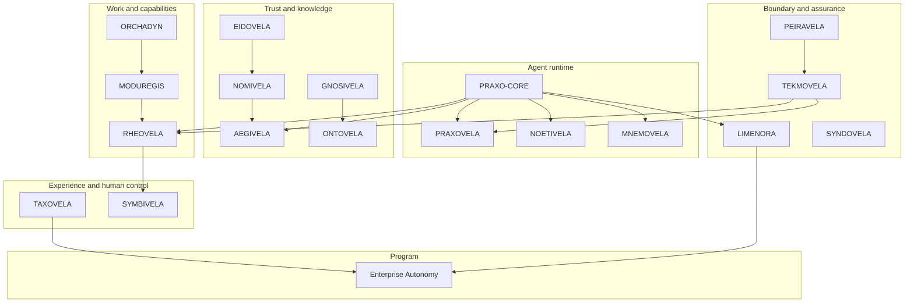

# Reference architecture

A reference view of an agent system that can be governed. It is deliberately
layered: each layer has a job, and the seams between layers are contracts.

## A request, end to end

A governed agent request usually crosses the following boundaries:

1. **Intent.** A person or system states a goal and the success criteria.
2. **Plan.** A planner turns the goal and constraints into a structured plan
   ([ORCHADYN](../projects/orchadyn.md)).
3. **Capability check.** Each step is checked against a governed capability
   catalog ([MODUREGIS](../projects/moduregis.md)).
4. **Authorization.** Identity, registry context, and policy decide whether the
   step is allowed ([EIDOVELA](../projects/eidovela.md),
   [NOMIVELA](../projects/nomivela.md),
   [AEGIVELA](../projects/aegivela.md)).
5. **Execution.** A runtime or workflow executes within a sandbox and budget
   ([PRAXOVELA](../projects/praxovela.md),
   [RHEOVELA](../projects/rheovela.md)).
6. **Boundary crossing.** External calls go through a governed gateway
   ([LIMENORA](../projects/limenora.md)).
7. **Evidence.** The system records what was intended, allowed, done, and
   observed.
8. **Verification.** Acceptance criteria are checked against evidence
   ([TEKMOVELA](../projects/tekmovela.md)), optionally after simulation
   ([PEIRAVELA](../projects/peiravela.md)).
9. **Human decision.** A person approves, intervenes, or accepts the outcome
   ([SYMBIVELA](../projects/symbivela.md)).

Not every request needs every step. A low-risk local agent may skip the workflow
engine and the approval queue. The architecture should make the omissions
explicit, not accidental.

## The minimum governed agent

A useful minimum for many local use cases:

- PRAXO-CORE for the loop and primitives;
- a policy hook and a sandbox;
- a bounded tool set;
- an effect record and a trace;
- an identity and an authority scope;
- a human review step for high-risk actions.

That is enough to demonstrate governed behavior without deploying the entire
ecosystem.

## The seams

The reference architecture is held together by contracts, not a shared runtime
kernel:

- PRAXO-CORE exposes model, tool, memory, event, policy, sandbox, checkpoint, and
  execution seams.
- Product open surfaces expose versioned APIs, SDKs, and conformance fixtures.
- Harmovela defines coordination semantics.
- Enterprise Autonomy shows the composition in runnable examples.

See [Contracts](contracts.md) and the
[ecosystem map](../ecosystem-map.md) for the project-level view.

## What this architecture is not

- It is not a mandatory deployment topology.
- It is not a claim that every product is production-ready.
- It is not a single-vendor stack: the contracts are intended to be
  implementable by others.
