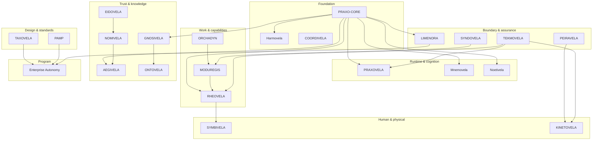

# Ecosystem map

The map is organized by **the job a project does**, not by repository age or
deployment topology. Projects can be adopted independently; the arrows show
integration seams, not mandatory dependencies.

## Design and standards

**What it answers:** What should the system look like, and how do we know the
design is sound?

- [TAXOVELA](projects/taxovela.md) turns requirements into architecture
  artifacts and validates them with deterministic gates.
- [PAMP](projects/pamp.md) is a practical enterprise-architecture management
  platform for the portfolio around those designs.

These are design-time tools. They do not execute agents; they make the
architecture around agents reviewable.

## Foundation

**What it answers:** What do we build on, and how do independent pieces
coordinate?

- [PRAXO-CORE](projects/praxo-core.md) is the MIT-licensed agent framework:
  loop, primitives, adapters, policy, sandbox, plugins.
- [Harmovela](projects/harmovela.md) is the open protocol for asynchronous
  coordination: events, tasks, state, delegation, recovery, governance.
- [COORDIVELA](projects/coordivela.md) applies coordination to development work
  itself: leases, dependencies, conflicts, interventions.

The foundation is deliberately small. It provides seams, not a monolithic
runtime.

## Runtime and cognition

**What it answers:** Where does the agent actually run, what does it remember,
and which model answers?

- [PRAXOVELA](projects/praxovela.md) is the local-first desktop agent runtime
  with a deny-by-default capability gate and an effect ledger.
- [Mnemovela](projects/mnemovela.md) is the cognition runtime: typed memory,
  branch semantics, hybrid retrieval, governed forgetting.
- [Noetivela](projects/noetivela.md) is the inference fabric: model/endpoint
  catalog, inference contracts, and governed routing.

## Work and capabilities

**What it answers:** What is the system allowed to do, what is the plan, and how
does work survive failure?

- [ORCHADYN](projects/orchadyn.md) compiles goals, state, capabilities, and
  constraints into verified, revisable plans.
- [MODUREGIS](projects/moduregis.md) is the capability control plane: publish,
  discover, authorize, invoke, audit.
- [RHEOVELA](projects/rheovela.md) turns governed capability plans into durable,
  recoverable process instances.

The typical flow is **plan → govern → execute → verify**, but each project is
useful on its own.

## Trust and knowledge

**What it answers:** Who is acting, what are they allowed to do, and what is
true?

- [EIDOVELA](projects/eidovela.md) issues agent identity and workload
  attestation.
- [NOMIVELA](projects/nomivela.md) is the registry and namespace authority:
  identities, authority bindings, lifecycle epochs.
- [AEGIVELA](projects/aegivela.md) evaluates policy, attenuates delegated
  authority, and enforces decisions through PEPs.
- [GNOSIVELA](projects/gnosivela.md) governs concepts, entities, claims,
  evidence, and conflicts, then projects scoped grounding views.
- [ONTOVELA](projects/ontovela.md) maintains an evidence-bearing, bitemporal
  operational world model and digital twin.

Identity and knowledge are separate concerns. A valid identity does not make a
claim true; a grounded claim does not grant permission.

## Boundary and assurance

**What it answers:** How does the system touch the outside world, and how do we
know it still behaves correctly?

- [LIMENORA](projects/limenora.md) is the governed north-south boundary for
  APIs, MCP servers, events, webhooks, and partner systems.
- [TEKMOVELA](projects/tekmovela.md) turns intent into verification contracts,
  runs reproducible tests, and gates releases.
- [PEIRAVELA](projects/peiravela.md) runs possible-world experiments with
  provenance-complete simulation evidence.
- [SYNDOVELA](projects/syndovela.md) governs agent-skill composition and the
  supply chain around it.

## Human and physical operations

**What it answers:** How do humans stay in control, and how does autonomy reach
the physical world?

- [SYMBIVELA](projects/symbivela.md) is the human-agent collaboration workspace:
  goals, plan review, approvals, exceptions, intervention, outcomes, evidence.
- [KINETOVELA](projects/kinetovela.md) is the physical-autonomy control plane
  for safe, observable robot-fleet missions.

## Program

**What it answers:** How do the pieces compose into something end-to-end?

- [Enterprise Autonomy](projects/enterprise-autonomy.md) is the public
  introduction and runnable-example program. It is the best place to see the
  products working together without reading every repository.

## How to read the arrows

An arrow means “this project produces something the other can consume,” not
“this project requires the other.” Examples:

- PRAXO-CORE exposes seams that NOETIVELA, MNEMOVELA, HARMOVELA, GNOSIVELA,
  AEGIVELA, LIMENORA, and RHEOVELA can fill.
- EIDOVELA issues identity, NOMIVELA records it, and AEGIVELA authorizes what
  the identity may do.
- ORCHADYN produces plans, MODUREGIS governs capabilities, and RHEOVELA
  executes and recovers process instances.

See the full [relationship index](reference/relationships.md) for the edge list
and the reasoning.
