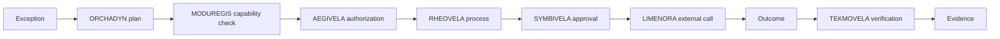

# End to end with AxisVela

This guide walks through a complete governed workflow using the AxisVela
projects as the example. The scenario is an order-fulfillment exception; the
pattern applies to procurement, maintenance, customer cases, and mission
execution.

## The scenario

An order cannot be fulfilled as planned. The system must:

1. detect the exception;
2. propose a revised plan;
3. check capabilities and policy;
4. run a durable process;
5. ask a human to approve the high-risk step;
6. call an external system through a governed gateway;
7. verify the outcome;
8. retain evidence.

## The architecture

## Step by step

### 1. Detect and state the goal

The event (stockout, delay, failure) enters the system. Record the goal and the
acceptance criteria. Do not start with a tool call.

**Evidence:** goal record, triggering event.

### 2. Compile a plan

[ORCHADYN](../projects/orchadyn.md) turns the goal, current state, capabilities,
and constraints into a structured plan: substitute, split shipment, refund, or
escalate.

**Evidence:** plan, alternatives, revision history.

### 3. Check capabilities and policy

[MODUREGIS](../projects/moduregis.md) checks that each step maps to a governed
capability. [AEGIVELA](../projects/aegivela.md) authorizes the invocation under
the agent’s identity and scope.

**Evidence:** capability version, policy decision, identity.

### 4. Run the process

[RHEOVELA](../projects/rheovela.md) creates a durable process instance. Each
step is idempotent and recorded. If the process crashes, it resumes without
repeating external effects.

**Evidence:** process history, command records, state transitions.

### 5. Ask for approval

[SYMBIVELA](../projects/symbivela.md) presents the high-risk step (for example, a
refund above a threshold) with the plan, evidence, and consequences. A human
approves, denies, or modifies it.

**Evidence:** approval decision, approver, rationale.

### 6. Cross the boundary

[LIMENORA](../projects/limenora.md) forwards the approved request to the external
fulfillment system, injecting credentials and enforcing the destination policy.

**Evidence:** request metadata, policy decision, response status.

### 7. Verify the outcome

[TEKMOVELA](../projects/tekmovela.md) checks the outcome against the acceptance
criteria. If the change is high-risk, [PEIRAVELA](../projects/peiravela.md) can
simulate it first.

**Evidence:** verification contract, result, trace links.

### 8. Retain and review

The evidence chain is retained according to policy. The process closes with an
outcome that can be audited and learned from.

## What to notice

- **No single component owns the whole decision.** Each layer owns a question.
- **The human is not a rubber stamp.** The approval has context and evidence.
- **The external call is not direct.** It crosses a governed boundary.
- **The process is recoverable.** A crash does not create a duplicate refund.
- **The outcome is verified.** The process does not grade its own homework.

## Run it locally

The runnable version lives in
[Enterprise Autonomy](https://github.com/axisvela/enterprise-autonomy):

- [Order fulfillment exception](https://github.com/axisvela/enterprise-autonomy/tree/main/examples/order-fulfillment-local)
- [Demo matrix](https://github.com/axisvela/enterprise-autonomy/blob/main/docs/demo-matrix.md)
- [Technical catalog](https://github.com/axisvela/enterprise-autonomy/blob/main/docs/technical-catalog.md)

Start with one demo, follow the evidence across the logs and APIs, then remove
components to see which control you lose.

## A minimal version

If the full stack is too much, keep the shape:

- PRAXO-CORE for the agent;
- a policy hook and a sandbox;
- a local effect ledger;
- one approval step;
- one governed external call;
- one verification check.

The names change; the boundaries do not.
