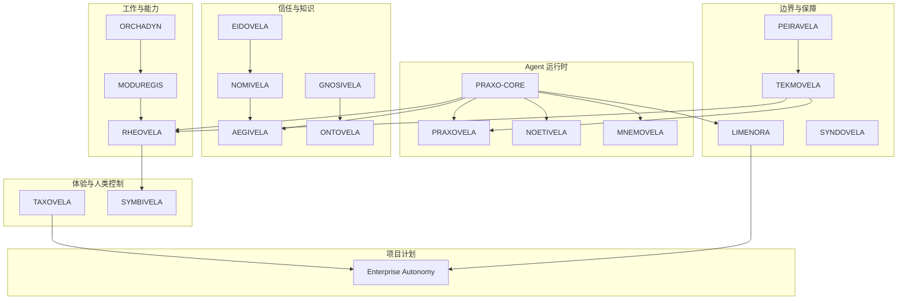

# 参考架构

[English](../../architecture/reference-architecture.md) | 中文

这是一张可治理 Agent 系统的参考视图。它刻意分层：每层有明确职责，层与层之间是契约。

## 一次请求的端到端路径

一个受治理的 Agent 请求通常跨越以下边界：

1. **意图。** 人或系统陈述目标与成功标准。
2. **计划。** 规划器把目标与约束变成结构化计划
   （[ORCHADYN](../projects/orchadyn.md)）。
3. **能力检查。** 每一步对照受治理的能力目录
   （[MODUREGIS](../projects/moduregis.md)）。
4. **授权。** 身份、注册上下文与策略决定该步骤是否允许
   （[EIDOVELA](../projects/eidovela.md)、[NOMIVELA](../projects/nomivela.md)、
   [AEGIVELA](../projects/aegivela.md)）。
5. **执行。** 运行时或工作流在沙箱与预算内执行
   （[PRAXOVELA](../projects/praxovela.md)、[RHEOVELA](../projects/rheovela.md)）。
6. **跨越边界。** 外部调用经过受治理网关
   （[LIMENORA](../projects/limenora.md)）。
7. **证据。** 系统记录意图、允许、执行与观测。
8. **验证。** 用证据检查验收标准（[TEKMOVELA](../projects/tekmovela.md)），
   必要时先做仿真（[PEIRAVELA](../projects/peiravela.md)）。
9. **人类决定。** 人批准、干预或接受结果（[SYMBIVELA](../projects/symbivela.md)）。

不是每个请求都需要所有步骤。低风险本地 Agent 可以跳过工作流引擎和审批队列。架构应让
省略是显式的，而不是偶然的。

## 最小可治理 Agent

许多本地场景的最小组合：

- PRAXO-CORE 提供循环与原语；
- 一个策略钩子和沙箱；
- 一组受限工具；
- 效果记录与追踪；
- 一个身份与权限范围；
- 高风险行动的人类评审。

这足以展示可治理行为，而不必部署整个生态。

## 接缝

参考架构由契约连接，而不是共享运行时内核：

- PRAXO-CORE 暴露模型、工具、记忆、事件、策略、沙箱、检查点与执行接缝。
- 产品开放接口层暴露版本化 API、SDK 与一致性夹具。
- Harmovela 定义协调语义。
- Enterprise Autonomy 用可运行示例展示组合。

项目级视图见[契约](contracts.md)与[生态地图](../ecosystem-map.md)。

## 这个架构不是什么

- 不是强制部署拓扑。
- 不是声称每个产品都已生产就绪。
- 不是单一厂商栈：契约允许其他实现。
