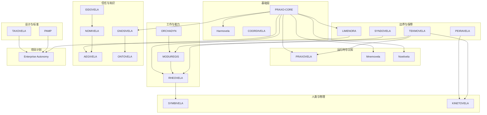

# 生态地图

[English](../ecosystem-map.md) | 中文

这张地图按**项目承担的工作**组织，而不是按仓库年龄或部署拓扑组织。项目可以独立采用；
箭头表示集成接缝，不表示强制依赖。

## 设计与标准

**回答的问题：** 系统应该长什么样，我们怎么知道设计是可靠的？

- [TAXOVELA](projects/taxovela.md) 把需求转化为架构产物，并用确定性门禁验证。
- [PAMP](projects/pamp.md) 是面向架构组合的实用企业管理平台。

这些是设计时工具。它们不执行 Agent，但让 Agent 周围的架构可评审。

## 基础层

**回答的问题：** 我们构建在什么之上，独立部件如何协调？

- [PRAXO-CORE](projects/praxo-core.md) 是 MIT 许可的 Agent 框架：循环、原语、适配器、
  策略、沙箱、插件。
- [Harmovela](projects/harmovela.md) 是异步协调的开放协议：事件、任务、状态、委托、
  恢复、治理。
- [COORDIVELA](projects/coordivela.md) 把协调用于开发工作本身：租约、依赖、冲突、干预。

基础层刻意保持小。它提供接缝，而不是单体运行时。

## 运行时与认知

**回答的问题：** Agent 在哪里运行、记得什么、由哪个模型回答？

- [PRAXOVELA](projects/praxovela.md) 是本地优先的桌面 Agent 运行时，默认拒绝、
  有沙箱和效果账本。
- [Mnemovela](projects/mnemovela.md) 是认知运行时：类型化记忆、分支语义、混合检索、
  受治理的遗忘。
- [Noetivela](projects/noetivela.md) 是推理织构：模型/端点目录、推理契约、受治理路由。

## 工作与能力

**回答的问题：** 系统允许做什么、计划是什么、工作如何跨故障存活？

- [ORCHADYN](projects/orchadyn.md) 把目标、状态、能力、约束编译成可验证、可修订的计划。
- [MODUREGIS](projects/moduregis.md) 是能力控制平面：发布、发现、授权、调用、审计。
- [RHEOVELA](projects/rheovela.md) 把受治理的能力计划转化为持久、可恢复的流程实例。

典型路径是**规划 → 治理 → 执行 → 验证**，但每个项目都可以单独使用。

## 信任与知识

**回答的问题：** 谁在行动、允许做什么、什么是真的？

- [EIDOVELA](projects/eidovela.md) 签发 Agent 身份与工作负载证明。
- [NOMIVELA](projects/nomivela.md) 是注册中心与命名空间权威：身份、权限绑定、生命周期纪元。
- [AEGIVELA](projects/aegivela.md) 评估策略、衰减委托权限，并通过 PEP 执行决定。
- [GNOSIVELA](projects/gnosivela.md) 治理概念、实体、主张、证据与冲突，并投影出有范围的
  知识锚定视图。
- [ONTOVELA](projects/ontovela.md) 维护有证据、双时间的运营世界模型与数字孪生。

身份与知识是不同问题。有效身份不能证明主张为真；有据可依的主张也不能授予权限。

## 边界与保障

**回答的问题：** 系统如何接触外部世界，我们怎么知道它仍然正确？

- [LIMENORA](projects/limenora.md) 是面向 API、MCP、事件、Webhook 和合作伙伴系统的
  受治理南北向边界。
- [TEKMOVELA](projects/tekmovela.md) 把意图转化为验证契约，运行可复现测试，并设置发布门禁。
- [PEIRAVELA](projects/peiravela.md) 运行可能世界实验，产生完整溯源的仿真证据。
- [SYNDOVELA](projects/syndovela.md) 治理 Agent 技能组合及其供应链。

## 人类与物理操作

**回答的问题：** 人类如何保持控制，自治如何进入物理世界？

- [SYMBIVELA](projects/symbivela.md) 是人机协作工作台：目标、计划评审、审批、异常、
  干预、结果与证据。
- [KINETOVELA](projects/kinetovela.md) 是面向安全、可观测机器人集群任务的物理自治控制平面。

## 项目计划

**回答的问题：** 这些部件如何组合成端到端系统？

- [Enterprise Autonomy](projects/enterprise-autonomy.md) 是公开介绍与可运行示例计划。
  这是不读每个仓库也能看到产品如何协作的最佳入口。

## 如何读箭头

箭头表示“这个项目产出某种可被另一个项目消费的东西”，而不是“这个项目依赖另一个项目”。
例如：

- PRAXO-CORE 暴露的接缝可以由 NOETIVELA、MNEMOVELA、HARMOVELA、GNOSIVELA、AEGIVELA、
  LIMENORA、RHEOVELA 填充。
- EIDOVELA 签发身份，NOMIVELA 记录身份，AEGIVELA 决定身份可以做什么。
- ORCHADYN 产出计划，MODUREGIS 治理能力，RHEOVELA 执行并恢复流程实例。

完整边列表与原因见[关系索引](reference/relationships.md)。
