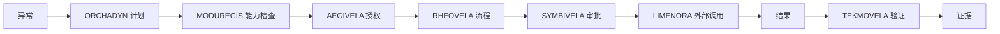

# 以 AxisVela 为例的端到端实践

[English](../../practice/end-to-end.md) | 中文

本指南用一个完整的受治理工作流走一遍 AxisVela 项目。场景是订单履约异常；同样模式适用于
采购、维护、客户案例与任务执行。

## 场景

订单无法按计划履约。系统需要：

1. 检测异常；
2. 提出修订计划；
3. 检查能力与策略；
4. 运行持久流程；
5. 请人批准高风险步骤；
6. 通过受治理网关调用外部系统；
7. 验证结果；
8. 保留证据。

## 架构

## 分步说明

### 1. 检测并陈述目标

事件（缺货、延迟、失败）进入系统。记录目标与验收标准。不要从工具调用开始。

**证据：** 目标记录、触发事件。

### 2. 编译计划

[ORCHADYN](../projects/orchadyn.md) 把目标、当前状态、能力与约束变成结构化计划：替代、
拆单、退款或升级。

**证据：** 计划、备选方案、修订历史。

### 3. 检查能力与策略

[MODUREGIS](../projects/moduregis.md) 检查每一步是否映射到受治理能力。
[AEGIVELA](../projects/aegivela.md) 在 Agent 身份与范围下授权调用。

**证据：** 能力版本、策略决定、身份。

### 4. 运行流程

[RHEOVELA](../projects/rheovela.md) 创建持久流程实例。每一步幂等并记录。进程崩溃后可
恢复，而不重复外部效果。

**证据：** 流程历史、命令记录、状态转换。

### 5. 请求审批

[SYMBIVELA](../projects/symbivela.md) 展示高风险步骤（例如超过阈值的退款），附计划、
证据与后果。人批准、拒绝或修改。

**证据：** 审批决定、审批人、理由。

### 6. 跨越边界

[LIMENORA](../projects/limenora.md) 把批准的请求转发给外部履约系统，注入凭据并执行目标
策略。

**证据：** 请求元数据、策略决定、响应状态。

### 7. 验证结果

[TEKMOVELA](../projects/tekmovela.md) 对照验收标准检查结果。如果变更风险高，
[PEIRAVELA](../projects/peiravela.md) 可以先做仿真。

**证据：** 验证契约、结果、追踪链接。

### 8. 保留与复盘

证据链按策略保留。流程以可审计、可学习的结果关闭。

## 需要注意

- **没有单一组件拥有整个决定。** 每层拥有一个问题。
- **人不是橡皮图章。** 审批有上下文与证据。
- **外部调用不是直连。** 它跨越受治理边界。
- **流程可恢复。** 崩溃不会产生重复退款。
- **结果被验证。** 流程不会自己给自己打分。

## 本地运行

可运行版本在 [Enterprise Autonomy](https://github.com/axisvela/enterprise-autonomy)：

- [订单履约异常](https://github.com/axisvela/enterprise-autonomy/tree/main/examples/order-fulfillment-local)
- [示例矩阵](https://github.com/axisvela/enterprise-autonomy/blob/main/docs/demo-matrix.md)
- [技术目录](https://github.com/axisvela/enterprise-autonomy/blob/main/docs/technical-catalog.md)

从一个示例开始，沿着日志与 API 跟踪证据，然后移除组件，看看你失去了哪个控制。

## 最小版本

如果完整栈太重，保留形状：

- PRAXO-CORE 作为 Agent；
- 策略钩子与沙箱；
- 本地效果账本；
- 一个审批步骤；
- 一次受治理外部调用；
- 一次验证检查。

名字会变，边界不变。
